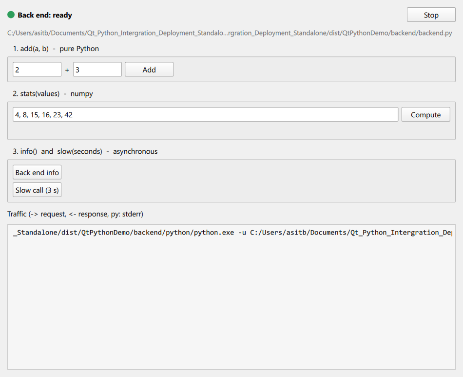

# Qt + Python in one standalone bundle (Windows and Linux)

A minimal, complete example of a **Qt (C++ / QML) front end** that drives a
**Python back end**, packaged by **one command** into **one folder that runs on a machine
without Qt, Python or any package installed**.

Use it as the template for a real application: replace `backend/backend.py` with your own
Python, keep the three files of the front end, run `tools/package.py`, ship the folder.



```
   QtPythonDemo (Qt 6, C++ + QML)                     backend/python/…  backend/backend.py
   ┌──────────────────────────────┐   stdin (JSON)   ┌───────────────────────────────────────┐
   │ Main.qml  ──►  Backend (C++) │ ───────────────► │ {"id":1,"method":"add","params":{..}} │
   │           ◄──  QProcess      │ ◄─────────────── │ {"id":1,"result":5}                   │
   └──────────────────────────────┘   stdout (JSON)  └───────────────────────────────────────┘
```

The front end starts the Python as a child process and exchanges one JSON object per line.
No sockets, no ports, no extra libraries on either side.

> **Want the details?** [`docs/PACKAGING.md`](docs/PACKAGING.md) explains, step by step, what
> `tools/package.py` does, which tool packages which half, why, and how to adapt it to your project.

## Contents

| Path | What it is |
|------|------------|
| `frontend/main.cpp` | starts the QML engine (and the `--selftest` / `--screenshot` helpers) |
| `frontend/backend.h`, `backend.cpp` | **the integration**: `Backend` runs the Python with `QProcess`, sends requests, receives answers, exposed to QML as `Backend { }` |
| `frontend/qml/Main.qml` | the demo UI: three buttons that call Python, a live log of the JSON traffic |
| `backend/backend.py` | **the Python side**: a dictionary of functions and a 20-line loop that reads requests and writes answers |
| `backend/requirements.txt` | the Python packages the back end needs (here `numpy`, to show that third-party packages ship too) |
| `tools/package.py` | **one command** that builds the exe, adds the Qt runtime, adds a private Python with the packages, tests the result and archives it. Windows, Linux, macOS |
| `tools/check_deps.py` | release check used by `package.py`: every library the bundle needs is inside the bundle (PE import tables on Windows, `ldd` on Linux) |
| `CMakeLists.txt` | the Qt project (open it in Qt Creator); also holds the install/deploy rules used on Linux and macOS |
| `docs/PACKAGING.md` | the packaging guide: what the script does and why, bundle anatomy, CI, troubleshooting |

## Step 1 - install the tools (build machine only)

**Windows**

1. **Qt 6** (6.5 or newer) with the *MinGW 64-bit* kit, plus *CMake* and *Ninja* from the same Qt
   installer (they land in `C:\Qt\Tools`). Tested with Qt 6.9.2.
2. **Python 3** (3.10 or newer) with pip. Tested with 3.13. Any install is fine, also the one from
   the Microsoft Store.
3. **Git** (only to clone).

```bat
git clone https://github.com/asitbakade/Qt_Python_Intergration_Deployment_Standalone.git
cd Qt_Python_Intergration_Deployment_Standalone
pip install -r backend\requirements.txt
```

**Linux** (Ubuntu / Debian shown; any distribution works)

1. **Qt 6** (6.5 or newer): either the Qt online installer (*Desktop gcc 64-bit* kit, lands in
   `~/Qt/6.x.y/gcc_64`) or the distribution's packages
   (`sudo apt install qt6-declarative-dev qml6-module-qtquick-controls qml6-module-qtquick-layouts`;
   needs a distribution that ships Qt 6.5+, e.g. Ubuntu 24.10+, Debian 13). Tested with Qt 6.9.2 from the installer.
2. **Compiler, CMake, Ninja, Python 3 with pip** and the libraries a Qt application links against:

```sh
sudo apt install build-essential cmake ninja-build python3 python3-pip python3-venv git \
                 libgl-dev libegl-dev libxkbcommon-dev libxcb-cursor0
git clone https://github.com/asitbakade/Qt_Python_Intergration_Deployment_Standalone.git
cd Qt_Python_Intergration_Deployment_Standalone
pip3 install -r backend/requirements.txt       # or in a venv
```

## Step 2 - run it in development

Open `CMakeLists.txt` in Qt Creator, choose the *Desktop Qt 6.x* kit (MinGW 64-bit on Windows,
GCC 64-bit on Linux), press **Run**.

The app finds `backend/backend.py` in the source tree and runs it with the `python` / `python3` on
your PATH (the path is baked in by CMake, see `Backend::locate()` in `backend.cpp`). The status dot
turns green when the Python has printed its `ready` line. Press **Add**, **Compute** and
**Back end info**: every request and answer is shown in the log at the bottom.

You can also talk to the back end by hand:

```
python backend/backend.py
{"id": 1, "method": "add", "params": {"a": 2, "b": 3}}
```

## Step 3 - build the standalone bundle

```bat
python tools\package.py                 (Windows)
```
```sh
python3 tools/package.py                (Linux / macOS)
```

Add `--qt <kit folder>` if you have several Qt versions or an unusual location
(`C:\Qt\6.9.2\mingw_64`, `~/Qt/6.9.2/gcc_64`). The script prints each step and stops at the first
problem. About 2 minutes the first time (it downloads the private Python once and caches it in
`build/cache`). Result:

```
Windows   dist\QtPythonDemo\                        170 MB, runs anywhere
          dist\QtPythonDemo-windows-x86_64.zip      64 MB, what you send
Linux     dist/QtPythonDemo/                        265 MB, runs on any distribution as new as the build one
          dist/QtPythonDemo-linux-x86_64.tar.gz     90 MB, what you send
```

What the six steps do (the long version is [`docs/PACKAGING.md`](docs/PACKAGING.md)):

| Step | Does | With |
|---|---|---|
| 1 | builds `QtPythonDemo` in Release | CMake + the compiler of the Qt kit |
| 2 | copies **everything of Qt the exe needs**: libraries, plugins, the QML modules `Main.qml` imports, the C++ runtime | Windows: `windeployqt` · Linux/macOS: `cmake --install` running Qt's deploy script |
| 3 | copies `backend/` (your Python code) | plain copy, without caches |
| 4 | adds a **complete private Python** and installs `requirements.txt` into it | Windows: the python.org *embeddable* zip · Linux/macOS: *python-build-standalone* · `pip install --target` with the bundled interpreter's version and platform |
| 5 | **tests**: the bundled Python answers a request; every library the bundle needs is inside it (`check_deps.py`); the packaged app passes `--selftest` with the build machine's `PATH` reduced to the OS | |
| 6 | writes `README.txt` and the archive | zip on Windows, tar.gz on Linux |

Inside the bundle:

```
Windows                                        Linux
QtPythonDemo.exe            our front end      bin/QtPythonDemo           our front end (RPATH → ../lib)
Qt6Core.dll Qt6Quick.dll …  Qt runtime         bin/qt.conf                points Qt at plugins/ and qml/
libstdc++-6.dll …           MinGW runtime      lib/libQt6*.so.6 libicu*   Qt runtime
platforms/ imageformats/ …  Qt plugins         plugins/platforms/ …       Qt plugins
qml/QtQuick/ …              QML modules        qml/QtQuick/ …             QML modules
backend/backend.py          our Python code    backend/backend.py         our Python code
backend/python/python.exe   private Python     backend/python/bin/python3 private Python
backend/python/Lib/site-packages/numpy/        backend/python/lib/python3.12/site-packages/numpy/
README.txt                                     README.txt
```

## Step 4 - test it like the customer will

Copy the folder (or unpack the archive) to another machine, or to another folder on this one, and
start `QtPythonDemo.exe` (Windows) or `bin/QtPythonDemo` (Linux). Nothing is installed, nothing on
the machine is used.

Without clicking, from a terminal inside the folder:

```bat
QtPythonDemo.exe --selftest
echo %errorlevel%
```
```sh
bin/QtPythonDemo --selftest; echo $?
```

`0` means the front end loaded Qt from the bundle, started the bundled Python, called `add(2, 3)`
and got `5` back. `1` = the back end failed, `2` = no answer within 15 s. Use this on the target
machine, or in CI, before shipping. The packaging script already runs it once on the build machine.

That is all: four steps, one command. The rest of this file explains how the pieces work and how
to put your own project in.

## How the integration works

**Python side** (`backend/backend.py`): a dictionary `METHODS = {"add": add, "stats": stats, ...}`
and a loop:

```python
send({"event": "ready", ...})          # tells the front end we are up
for line in sys.stdin:                  # one request per line
    req = json.loads(line)
    result = METHODS[req["method"]](**req["params"])
    send({"id": req["id"], "result": result})
```

`send` writes one line to stdout and **flushes** it. Errors go back as
`{"id": .., "error": "..."}`, so one bad request never kills the process. The loop ends when stdin
is closed, which the front end does on exit.

**C++ side** (`frontend/backend.cpp`): `Backend::start()` finds the Python (bundle first, then
PATH, then the source tree), sets `PYTHONUNBUFFERED=1` and `PYTHONIOENCODING=utf-8`, and starts it
with `QProcess`. `call(method, params)` writes one JSON line and returns a request id;
`onStdout()` splits the output into lines and emits `replied(id, method, result)` or
`failed(id, method, error)`. Nothing blocks the UI: the 3-second "slow call" in the demo leaves
the window fully responsive.

**QML side** (`frontend/qml/Main.qml`):

```qml
Backend { id: backend; Component.onCompleted: start()
          onReplied: (id, method, result) => { if (method === "add") label.text = result } }
Button  { onClicked: backend.call("add", { a: 2, b: 3 }) }
```

**Why a private Python instead of PyInstaller?** The bundle carries the official CPython (the
python.org *embeddable* zip on Windows, *python-build-standalone* on Linux/macOS, the builds `uv`
and `pyenv` use) and your packages exactly as pip installed them. Nothing is repacked, so large or
awkward packages (numpy, scipy, torch, models) work the same as in development, and a problem is
debugged by running `backend/python/python.exe backend/backend.py` in the bundle. PyInstaller is a
fine alternative for a small pure-Python back end: then `backend.py` becomes `backend.exe` and
`Backend::locate()` starts that instead.

**Why stdin/stdout JSON?** It needs nothing: no ZeroMQ, no gRPC, no port that a firewall or another
instance can block, and the traffic is readable in the log pane. When you need streaming or several
clients, the same `Backend` class can be moved to a local socket; the packaging does not change.

## Putting your own project in

1. Copy your Python package next to `backend/backend.py` (or into a sub folder) and import it
   there; add one entry to `METHODS` per function the UI may call. Results must be JSON (numbers,
   strings, lists, dicts; convert numpy with `.tolist()` / `float()`).
2. Put the packages in `backend/requirements.txt` with **pinned versions** for reproducible bundles.
3. Replace `Main.qml` with your UI; keep `Backend { }` and call `backend.call(...)`.
4. Rename `QtPythonDemo` in `CMakeLists.txt` and `tools/package.py` (`APP = ...`).
5. Data files (models, weights, configs) go under `backend/`; `package.py` copies the whole folder.
   Big files that must not be in git are downloaded by a step you add to `package.py`.
6. Run `tools/package.py`. If the release check at the end fails, it names the library that would be
   missing on a clean machine; [`docs/PACKAGING.md`](docs/PACKAGING.md#15-troubleshooting) says what
   to do for each case.

## Troubleshooting

| Symptom | Cause / fix |
|---------|-------------|
| Status *error: no Python back end found* | In development: no `python` / `python3` on PATH. In the bundle: `backend/python/` missing or at the wrong level (next to the exe on Windows, next to `bin/` on Linux); copy the whole folder |
| Status *error: back end exited with code 1* | Python raised at start-up (import error ...). Run `backend/python/python.exe -u backend/backend.py` (Linux: `backend/python/bin/python3 ...`) in a terminal to see the traceback |
| Request answered, but late | Output buffering: keep `flush()` in `send()` and `-u` / `PYTHONUNBUFFERED=1` (both already there) |
| `ModuleNotFoundError` in the bundle only | The package is not in `requirements.txt`, or (Windows) `python313._pth` lost its `Lib\site-packages` line |
| *The specified module could not be found* on the target PC | A DLL from your PC was needed: `python tools/check_deps.py dist/QtPythonDemo` names it; ship it inside `backend/python/` |
| *Could not load the Qt platform plugin "xcb"* on a target Linux | Install `libxcb-cursor0` (Qt 6.5+ needs it); `QT_DEBUG_PLUGINS=1 bin/QtPythonDemo` prints the missing library |
| Antivirus / SmartScreen warning on the target PC | Unsigned executable. Sign `QtPythonDemo.exe` with your code-signing certificate (signtool) after `package.py` |
| A console window flashes | Only if the exe was built without `WIN32_EXECUTABLE`; the Python child never shows a console because Qt starts it with `CREATE_NO_WINDOW` |
| Bundle too large | `opengl32sw.dll` (20 MB, software OpenGL fallback) and `D3Dcompiler_47.dll` can be deleted when every target PC has a working GPU driver; QML style folders under `qml/` you do not use can go too |

More cases, with the step of the script they belong to, in
[`docs/PACKAGING.md`, section 15](docs/PACKAGING.md#15-troubleshooting).

## Platforms

| | Build | Bundle | Status |
|---|---|---|---|
| Windows 10/11 | Qt 6.9.2 MinGW, Python 3.13 | `windeployqt` + python.org embeddable zip | verified (full script run, self-test with PATH reduced to Windows) |
| Linux | Qt 6.9.2 gcc_64, Python 3.12 | Qt CMake deploy API + python-build-standalone | verified on Ubuntu 24.04 (WSL 2): full script run, self-test with a display and headless |
| macOS | Qt 6.5+ macos kit | same CMake deploy API (`.app`) + python-build-standalone | code path present, not run |
